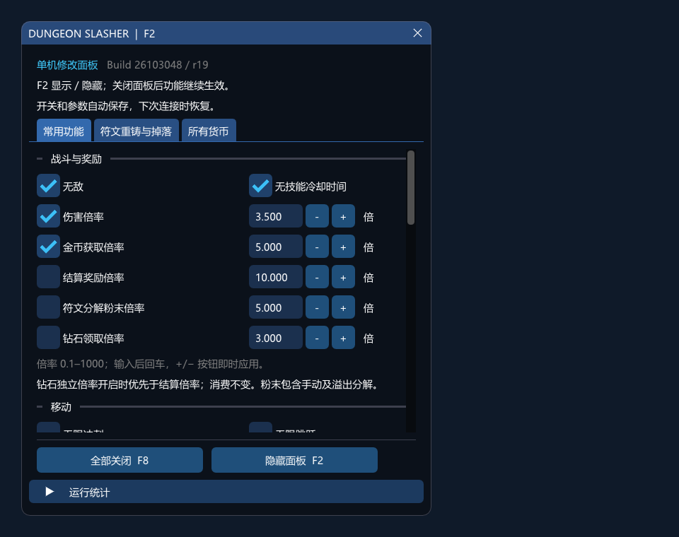
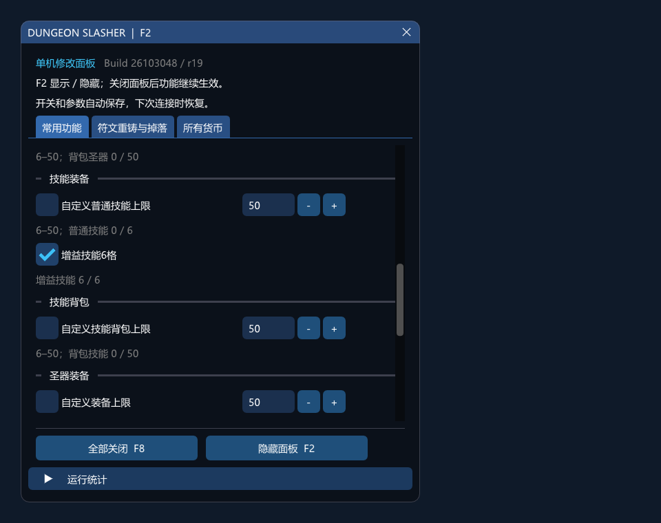
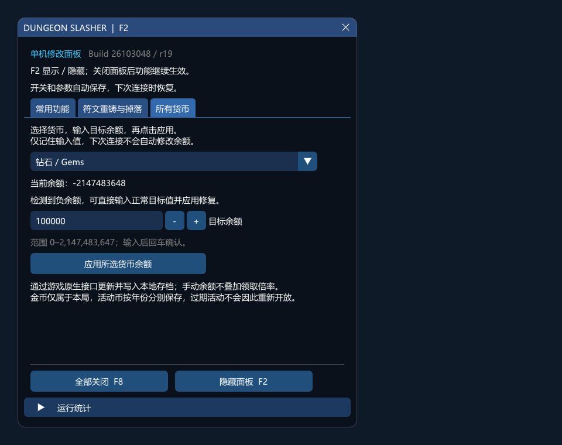

# God for DUNGEON SLASHER

[](https://github.com/2683445453/God-for-Dungeon-slasher/actions/workflows/windows.yml)
[](https://github.com/2683445453/God-for-Dungeon-slasher/releases/latest)
[](LICENSE)

面向《DUNGEON SLASHER》Windows Steam 版的本地修改器，提供中文游戏内面板、角色与宠物解锁、货币编辑、装备和背包扩容、符文调整等功能。

**当前版本：r19 · Steam Build 26103048 · Windows x64 / D3D11。** 其他游戏版本需要等待对应适配。

[下载分发版](https://github.com/2683445453/God-for-Dungeon-slasher/releases/latest) · [更新日志](CHANGELOG.md) · [详细使用说明](docs/使用说明.txt) · [问题反馈](https://github.com/2683445453/God-for-Dungeon-slasher/issues)

## 下载与启动

1. 在 [Releases](https://github.com/2683445453/God-for-Dungeon-slasher/releases/latest) 下载 `dungeon-slasher-r19.zip`。页面中的 **Source code** 是源码，需要自行编译。
2. 完整解压到可写文件夹，保持 `DungeonSlasherTrainer.exe` 与 `DungeonSlasher.Runtime.dll` 在一起。
3. 启动游戏并进入主菜单，再运行 `DungeonSlasherTrainer.exe`。程序会自动检测游戏、校验版本、备份存档并连接。
4. 保持修改器运行，可最小化。**F2** 显示或隐藏面板，**F8** 关闭全部功能；隐藏面板后已开启的功能继续生效。
5. 输入数值后按回车提交，`+ / −` 按钮即时应用。调整容量前先关闭游戏的角色、圣器或技能窗口。

更新前请**完全退出游戏和旧修改器**，再解压新版。可保留旧版 `trainer.ini` 沿用设置。

发布页同时提供同名 `.sha256` 校验文件，可使用 PowerShell 核对下载：

```powershell
Get-FileHash -Algorithm SHA256 .\dungeon-slasher-r19.zip
Get-Content .\dungeon-slasher-r19.sha256
```

## 功能

| 分类 | 功能与范围 |
| --- | --- |
| 战斗 | 无敌；伤害倍率 0.1–1000 |
| 移动 | 无限冲刺、无限跳跃 |
| 冷却 | 普通技能、增益技能和武器技能无冷却，恢复武器技能次数 |
| 收益 | 金币、结算奖励、符文粉末、钻石独立倍率 0.1–1000 |
| 容量 | 圣器装备、普通技能装备、圣器背包、技能背包分别可调 6–50；增益技能可扩展至 6 格 |
| 解锁 | 角色、皮肤、武器、宠物解锁；一键解锁可用技能和圣器 |
| 罪恶 | 总点数 0–140，七项分配各最多 20 |
| 符文 | 重铸、精炼最高值；挑战符文掉落概率 0–100%，数量 1–20 倍 |
| 货币 | 41 项货币目标余额编辑，支持负余额恢复 |
| 连接 | 购买、重铸等操作的连接错误静默自动重试 |
| 配置 | 自动保存开关与参数，游戏重启后自动重新连接 |

### 容量与续局

- 四项容量独立开启，首次默认值为 12；需要 50 格时输入 50 并回车。增益技能使用独立开关，从原有 2 格扩展至 6 格。
- 缩容前先移走超额物品；有物品占用时会暂时保留容量，关闭开关不会删除物品。
- **点“继续”前先连接修改器。** 扩容存档需要兼容该容量功能、且适配当前游戏版本的修改器读取。
- 如需停用修改器，先移走超额物品，恢复四项原有容量及两格增益技能，再保存退出。

### 货币与负余额修复

在“所有货币”页选择类型，输入 **0–2,147,483,647** 的目标余额并回车，再点击“应用所选货币余额”。余额溢出为负数后，按相同方法即可恢复。

本局金币需进入关卡后修改，只对当前局有效。手动修改余额不叠加领取倍率；修改过期活动货币不会重新开放活动。

### 使用限制

- 无冷却仍保留动画、效果持续时间、角色专用资源及激活条件。
- 静默重试默认开启，重试间隔逐步增加至 32 秒。断网时操作仍需等待连接恢复；账号、凭证或参数错误仍按游戏提示处理。关闭此功能、按 F8 或退出修改器后，等待中的操作恢复手动提示。
- 解锁仅适用于已实装、可用的内容；本地修改不会生成 Steam 授权、付款凭证或服务端订单，服务器仍可能校验状态。
- 无敌保留主动献祭、最大生命变化和脚本直接死亡。符文调整保留材料费用、锁定条件及掉落资格，额外挑战符文单局待结算上限为 2000。
- 新版战斗、购买及断网恢复的实际表现仍需游戏内验证。

## 面板预览

以下为面板示意，非游戏实机截图。



<details>
<summary>查看容量和货币面板</summary>





</details>

## 配置与备份

设置保存在修改器同目录的 `trainer.ini`。下次连接会恢复开关和参数；修改余额、一键解锁等单次操作不会自动执行。主动按 F8 会记住全部关闭的状态，正常退出则保留此前设置。

每次新连接前，程序会将游戏存档和设置备份到同目录的 `backups` 文件夹。恢复前完全关闭游戏与修改器，保留当前存档副本，再将备份中的存档恢复到游戏存档位置；需要恢复设置时导入同一备份中的 `PlayerPrefs.reg`。恢复后注意核对云存档同步提示。

## 常见问题

**提示版本不支持**：确认使用与当前游戏版本匹配的分发版，更新后完全重启游戏。

**未发现游戏或 F2 面板不显示**：进入游戏主菜单，保留一个游戏进程，点击“重新检测”。确认已连接、游戏窗口有焦点，并使用支持的 D3D11 环境。

**容量未变化或解锁后未刷新**：确认对应开关已开启、数值已回车；关闭并重新进入角色或选择页面。缩容时先检查超额槽位。

**连接仍在等待**：自动重试需要网络和服务器恢复，不能保证所有操作立即完成。

**安全软件阻止运行**：先核对下载来源和 SHA-256，必要时向安全软件厂商提交文件复核。

反馈问题请提供游戏版本、修改器版本、操作步骤和错误提示，避免上传个人存档、备份或账号信息。

## 从源码构建

需要 Windows x64、PowerShell 7.2+、Visual Studio C++ Build Tools 和 Windows SDK。依赖已随仓库提供。

```powershell
git clone https://github.com/2683445453/God-for-Dungeon-slasher.git
cd God-for-Dungeon-slasher
./build.ps1 -SkipGameCheck
```

生成的 ZIP 和 SHA-256 文件位于 `dist` 文件夹。此命令跳过已安装游戏的版本检查；构建与发布流程见 [发布指南](docs/RELEASING.md)。

## 许可证与致谢

项目采用 [MIT License](LICENSE)。[MinHook](third_party/minhook/LICENSE.txt) 与 [Dear ImGui](third_party/imgui/LICENSE.txt) 保留各自版权和许可证，并随二进制分发。《DUNGEON SLASHER》的游戏名称、素材及游戏程序属于各自权利人，本仓库不分发游戏本体或资源。
